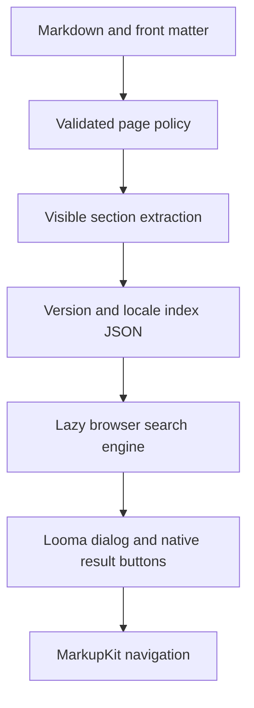
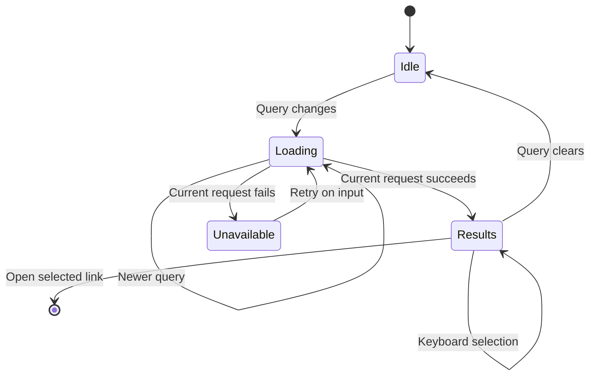

# Search and Internationalization Parity - Plan

## Goal Capsule

**Objective:** Readers can find documentation despite typing mistakes and read and navigate a documentation site in their language, with capabilities comparable to stable VitePress, Docusaurus and Starlight.

**Authority:** The requested outcome and sequential PR-to-deployment delivery govern this plan. Repository instructions govern ownership and verification. The acceptance details below are engineering interpretations of parity, not individually user-approved API requirements.

**Execution:** Deliver coherent increments, finishing publication and deployment verification before opening the next PR. Complete search and internationalization before authoring work. Preserve the current branch name and unrelated changes. An owned dependency defect must be fixed and published by its owner before integration.

---

## Product Contract

### Summary

Improve local search, add optional hosted search, and support localized documentation across versions. Preserve existing sites while adding localized reader controls, language switching, RTL layout and language metadata.

### Problem Frame

The current search controller matches substrings in a downloaded per-version index. Typing mistakes produce no results, authors cannot exclude content, and keyboard selection starts with the first result. The site language option only sets document metadata; it does not create language-specific routes or translate the reader controls.

### Requirements

**Search**

- R1. Local search finds prefixes and modest spelling mistakes, ranks relevant headings and titles ahead of incidental body matches, and returns readable section snippets.
- R2. Authors can exclude a page or part of its content from indexing and can disable search or configure its result limit and matching behavior.
- R3. Readers can navigate results with the keyboard, retain existing shortcuts and dialog dismissal, and understand empty, no-result and failed searches. Failed index requests remain retryable and stale requests cannot overwrite a newer query.
- R4. Search isolates both version and locale, produces valid links beneath a non-root base, and handles accents, case and languages without whitespace word boundaries.
- R5. Sites may configure a hosted provider comparable to Algolia DocSearch without losing a usable default local search. Provider credentials are public search-only credentials; service provisioning is separate from package support.

**Internationalization**

- R6. Locale configuration discovers translated content, defines default-locale URLs, and preserves the existing routing of sites without locale configuration.
- R7. Language switching resolves document identity independently of its route and preserves the selected version. Missing translations lead deliberately to an available page or locale home with an explanatory label.
- R8. Reader controls, search feedback, code actions, version notices, generated titles and date formatting support locale-specific strings and documented fallback behavior.
- R9. Pages emit the correct language, direction, canonical URL and alternate-language links, and use locale-specific navigation and assets.
- R10. RTL layouts preserve logical reading and keyboard order, mirror directional controls, and keep mixed code and text readable.

**Delivery**

- R11. Every increment passes focused tests, inner and PR verification, and packed installed development/production/browser contracts before delivery. Each PR reaches merge, automatic paired npm publication and verified deployed behavior before the next PR begins.
- R12. Documentation describes actual supported behavior and limitations; parity is established by acceptance evidence rather than a feature count.

### Scope Boundaries

Authoring features, including content inclusion, code imports, math and diagrams, are outside this goal. Routing and browser adoption belong to MarkupKit; shared component defects belong to Looma; Markdown syntax belongs to Expressmark. No second router, component runtime or Markdown parser is introduced.

Search is a discovery aid, not an access-control boundary. Excluded text remains in the public page. Search analytics, accounts, crawler provisioning and automatic translation are not needed for the requested documentation-site parity.

### Acceptance Examples

- AE1. Covers R1, R3: typing `instalation` finds Installation; ArrowDown changes the selected result and Enter opens that result.
- AE2. Covers R2: a page with `search: false` remains directly readable but has no search entries; text inside `data-search-ignore` is absent from entries while neighboring text remains.
- AE3. Covers R4, R7: on a French v1 page beneath `/manual/`, search returns only French v1 URLs and switching to Arabic opens that identity in v1 when present.
- AE4. Covers R7: when the selected identity has no Arabic translation in v1, its language switch names the missing translation and links to the Arabic v1 home.
- AE5. Covers R9, R10: an Arabic page emits `lang=ar` and `dir=rtl`, correct language alternates, and a mobile drawer whose position and focus order follow its direction.

### Sources

Official documentation observed 2026-10-28:

- [VitePress 1.6.4 search](https://vuejs.github.io/vitepress/v1/reference/default-theme-search): local fuzzy/prefix search, translations, exclusions, MiniSearch configuration and Algolia integration.
- [Starlight search](https://starlight.astro.build/guides/site-search/): default Pagefind, page and element exclusions, optional DocSearch.
- [Docusaurus 3.10.2 search](https://docusaurus.io/docs/search): first-class Algolia support and community local alternatives.
- [VitePress 1.6.4 i18n](https://vuejs.github.io/vitepress/v1/guide/i18n): locale content and language/direction/theme overrides.
- [Starlight i18n](https://starlight.astro.build/guides/i18n/): routing, fallback content, translated UI and RTL.
- [MiniSearch](https://lucaong.github.io/minisearch/): browser/Node fuzzy matching, prefix queries and field boosting.

Historical parity documents under `docs/plans` contain retired renderer assumptions and previously deferred i18n. This plan supersedes that deferral for this goal.

---

## Planning Contract

### Key Technical Decisions

- KTD1. Use MiniSearch for local matching rather than maintaining a bespoke fuzzy engine. It supplies tested ranking and fuzzy/prefix behavior and is the stable VitePress precedent. Keep the existing JSON section index and build the in-memory index lazily in the browser; measure a representative corpus before making scalability claims. Governs R1, R4.
- KTD2. Keep Looma's search shell and result rows. Audit their native focus behavior before adding Markupress result navigation. Use ordinary native buttons and MarkupKit navigation. Governs R3.
- KTD3. Index exclusion is Markupress content policy: boolean `search` front matter and the `data-search-ignore` HTML attribute. Ignore marked subtrees during section extraction without modifying rendered author content. Governs R2.
- KTD4. Preserve the current section-index URL contract. Site `search` accepts `false` or a local options object with `limit`, `fuzzy` and `prefix`; defaults retain 20 results, enable prefix matching and use modest fuzzy matching. Validate unsupported keys and invalid values. Governs R1, R2.
- KTD5. Implement locale policy through MarkupKit's existing page mounts and loader head data. Add locale to documentation identity keys and version selection policy; dependency shortcomings require owner fixes. Governs R4, R6–R10.

### Assumptions

The R1–R10 checklist is an engineering interpretation of the requested parity. Exact locale/provider configuration and which translations ship will be specified from the owning APIs before their implementation increments. A missing translated document will initially link to its locale home rather than silently present untranslated content. This provides predictable behavior without duplicating pages or falsely labeling source-language text.

The first increment is U1–U3 below. Later units remain in scope and need their concrete configuration contracts resolved after the preceding increment reaches deployment; their API details do not block local search work.

### High-Level Technical Design

---

## Implementation Units

### U1. Local search matching and configuration

**Goal:** Deliver R1, R2 and the local engine portion of R4. **Dependencies:** none.

**Files:** `src/search.ts` (new), `src/controllers/search.ts`, `src/site.ts`, `src/index.ts`, `theme/search.html`, `theme/chrome.html`, `theme/shell.html`, `theme/home.html`, `package.json`, `pnpm-lock.yaml`, `tests/search.test.ts` (new), `tests/site.test.ts`.

**Approach:** Apply KTD1 and KTD4. Keep the matching model independent of DOM handling. Pass validated local options through the existing layout/header/search prop boundary. Use native `Intl.Segmenter` for language-aware terms; preserve original text and offsets when producing snippets.

**Patterns:** `src/site.ts` validates plain options and filters loader props to each layout's contract; controllers consume installed `.js` imports.

**Test scenarios:**

1. Exact, prefix, typo and accent-insensitive queries find the expected headings; title matches outrank incidental body matches.
2. Multi-term queries require every term; empty and punctuation-only input return no results.
3. CJK text is searchable without inserted spaces; snippets retain combining characters and original content.
4. Search options change result count/matching; false disables UI and generated indexes; invalid keys/types fail clearly.
5. Versioned and root indexes preserve their non-root base and exclude other versions.

**Verification:** Focused matching/site tests and installed browser search in U3 pass; record corpus size, index bytes and measured build/query timings privately without an unmeasured advantage claim.

### U2. Page and subtree exclusions

**Goal:** Deliver R2 exclusions. **Dependencies:** U1.

**Files:** `src/content.ts`, `src/site.ts`, `tests/content.test.ts`, `tests/site.test.ts`.

**Approach:** Apply KTD3 to front matter validation, section extraction and index generation. Keep ignored headings from becoming section boundaries and retain separators around ignored blocks.

**Test scenarios:**

1. Covers AE2: page exclusion removes all its entries without removing its route or navigation.
2. Ignored text/headings/nested elements stay rendered but are absent from the index; adjacent indexed words remain separated.
3. A literal code example containing the exclusion attribute remains searchable as code.
4. Non-boolean front matter fails with its source filename.

**Verification:** Rendered-content and generated-index tests prove both visibility and exclusion.

### U3. Accessible search interaction and first delivery

**Goal:** Complete R3 and prove R1–R4 for the first increment. **Dependencies:** U1, U2.

**Files:** `src/controllers/search.ts`, `theme/search.html`, `tests/search.test.ts`, `tests/package.test.ts`, `README.md`, `website/docs/01.guide/08.search.md`, `website/docs/02.reference/01.configuration.md`.

**Approach:** Apply KTD2. Clear obsolete results on failure and empty input. Keep lazy fetch caching with retry, reject stale completion, and prevent disconnected controllers from updating state. Document local options and exclusions.

**Test scenarios:**

1. Covers AE1: shortcuts open the dialog; arrow keys select results; Enter opens the selected URL; Escape closes it.
2. Deferred requests completing in reverse order leave only current results; a failed request clears results and later input retries.
3. Packed installed production and development consumers resolve MiniSearch and the controller modules and pass the existing CSP/axe proofs.
4. Excluded phrases cannot be found through the installed browser dialog.

**Verification:** R11 gates pass; merge and verify the actual registry install, artifact provenance and site deployment before U4.

### U4. Locale content, identity and version policy

**Goal:** Deliver R4, R6, R7. **Dependencies:** U3 deployment.

**Files:** `src/site.ts`, `src/markdown.ts`, `src/versions.ts`, `src/locales.ts` (new), `src/index.ts`, `src/config.ts`, `theme/chrome.html`, `theme/shell.html`, `theme/home.html`, `tests/site.test.ts`, `tests/versions.test.ts`, `tests/package.test.ts`, locale guide (new).

**Approach:** Apply KTD5. Resolve concrete locale directory/default-prefix configuration before editing. Scope catalogs, navigation, assets and search by locale/version, keep logical IDs stable, and publish the missing-translation rule.

**Test scenarios:**

1. Existing unconfigured sites retain all URLs; configured English/French/Arabic sites serve distinct routes and indexes beneath a base.
2. Covers AE3, AE4: language/version switching preserves identity and handles missing counterparts deliberately.
3. Same ID in different locales is valid; duplicate ID within a locale/version fails.
4. Snapshots preserve translated sources and original relative asset/component links.

**Verification:** Packed installed dev/production browser flows cover both switches and translated content before this increment reaches R11 delivery.

### U5. Translated reader UI, RTL and language SEO

**Goal:** Deliver R8–R10. **Dependencies:** U4 deployment.

**Files:** locale catalog/module, `src/content.ts`, `src/site.ts`, `src/controllers/code.ts`, `src/controllers/shell.ts`, `theme/*.html`, `theme/theme.css`, `styles/prose.css`, `tests/content.test.ts`, `tests/site.test.ts`, `tests/package.test.ts`, locale guide and configuration reference.

**Approach:** Audit every reader-facing string and date. Use typed dictionaries with documented default fallback and placeholder substitution. Set page language/direction and reciprocal alternates through the owning head API. Use logical CSS and existing action-row ownership.

**Test scenarios:**

1. Custom French and Arabic dictionaries reach dialogs, code actions, version notices, navigation and dates; missing keys use documented fallback.
2. Covers AE5: Arabic desktop/mobile layout, directional icons, mixed code/text and focus order pass real browser assertions.
3. Canonical and language alternates identify available translations and respect base/version/aliases.
4. Navigation between languages updates head metadata and controls during MarkupKit in-place adoption.

**Verification:** Published consumer/browser evidence establishes localized behavior before R11 delivery.

### U6. Hosted search and final parity evidence

**Goal:** Deliver R5 and R12 and close remaining R4 evidence. **Dependencies:** U5 deployment.

**Files:** provider module/controller, `src/site.ts`, `src/index.ts`, theme search contract, `tests/search.test.ts`, `tests/site.test.ts`, `tests/package.test.ts`, search and locale guides, configuration reference.

**Approach:** Specify an optional Algolia-compatible search integration using public search-only credentials and locale/version filtering, retaining Looma controls. Verify the provider API and CSP requirements before implementation. Keep the local provider usable without any account.

**Test scenarios:**

1. Contract fixtures prove request format, locale/version filtering, result mapping, empty/error states and keyboard navigation.
2. An installed browser consumer exercises the network boundary with deterministic provider responses and unchanged local fallback configuration.
3. A representative larger multilingual corpus records index/load/query behavior and all parity requirements map to passing evidence.

**Verification:** R11 delivery completes and R12 documentation describes residual limitations accurately. Live hosted-account provisioning is not required to prove package integration.

---

## Verification Contract

Use Node 24 through the available version manager and Corepack pnpm. Run focused tests and `corepack pnpm verify:inner` during development, then `corepack pnpm verify:pr` before handoff. Run the packed browser contract with `MARKUPRESS_BROWSER_TEST=1 corepack pnpm exec vitest run tests/package.test.ts --maxWorkers=1`; never overlap foreground browser runners in this repository.

Review the owned diff once before committing, preserve truthful human attribution, and keep automatic PR watching enabled. Main's existing release workflow owns publication; no local npm publish or replacement release workflow is permitted. Verify source-specific artifacts, paired versions, provenance, an ordinary registry installation and deployed behavior after each merge.

---

## Definition of Done

Each unit's scenarios pass and documentation matches the delivered contract. All R-IDs have concrete acceptance evidence, all increments satisfy R11, and public examples contain no private context. Remove abandoned attempts, trial artifacts, temporary dependency paths and patches before delivery. Record actual remaining limitations rather than declaring parity from the checklist alone. Execution progress belongs outside this plan.
